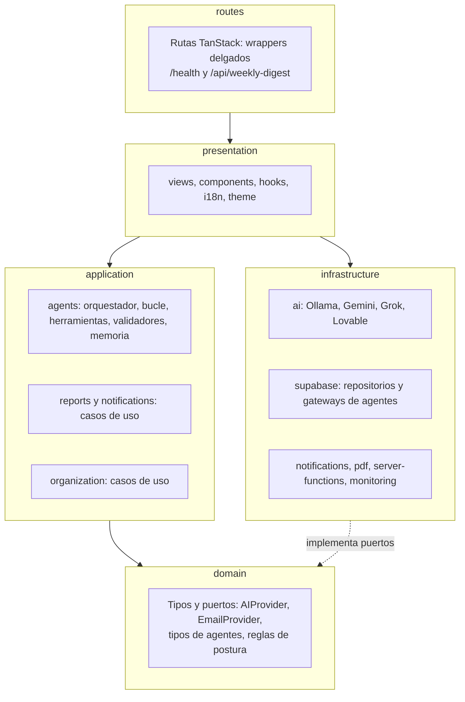
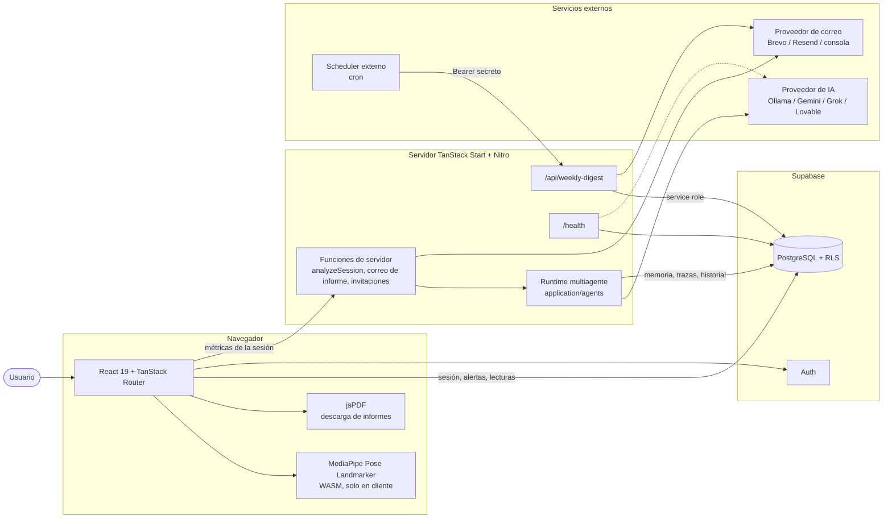
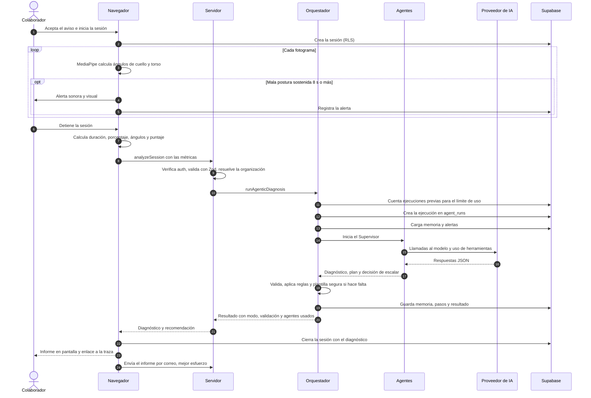
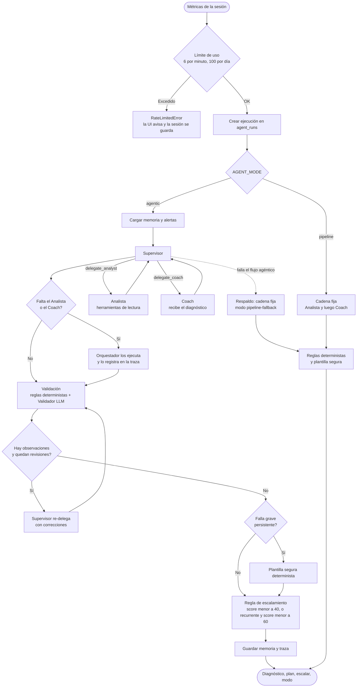
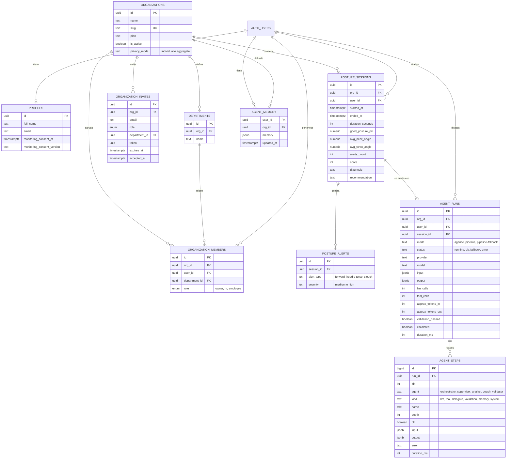
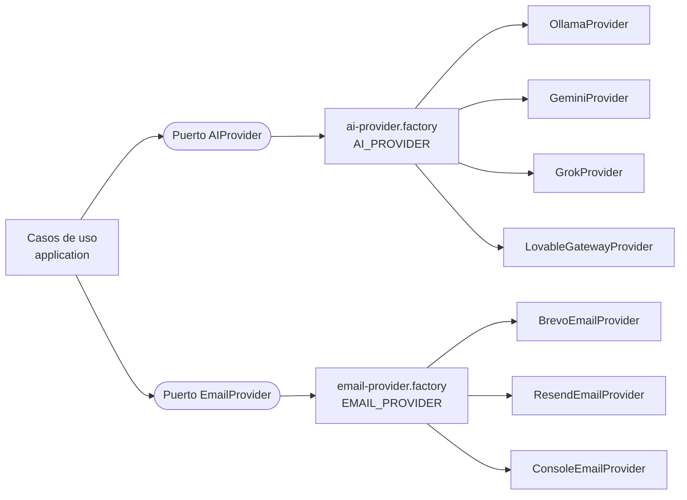
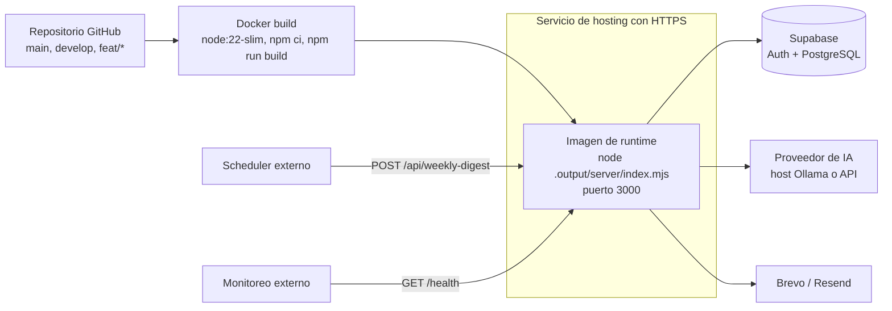

# Arquitectura de PosturaIA

Este documento describe cómo está construido PosturaIA: capas, componentes, el flujo del sistema multiagente, el modelo de datos, la seguridad y el despliegue. Los diagramas usan [Mermaid](https://mermaid.js.org) y se renderizan directamente en GitHub.

## Tabla de contenido

1. [Visión general](#1-visión-general)
2. [Arquitectura por capas](#2-arquitectura-por-capas)
3. [Diagrama de componentes](#3-diagrama-de-componentes)
4. [Flujo de una sesión de monitoreo](#4-flujo-de-una-sesión-de-monitoreo)
5. [Sistema multiagente](#5-sistema-multiagente)
6. [Modelo de datos](#6-modelo-de-datos)
7. [Seguridad y privacidad](#7-seguridad-y-privacidad)
8. [Proveedores intercambiables](#8-proveedores-intercambiables)
9. [Despliegue](#9-despliegue)
10. [Observabilidad y auditoría](#10-observabilidad-y-auditoría)
11. [Decisiones de diseño](#11-decisiones-de-diseño)
12. [Cómo extender el sistema](#12-cómo-extender-el-sistema)
13. [Limitaciones y deuda técnica](#13-limitaciones-y-deuda-técnica)

---

## 1. Visión general

PosturaIA combina tres piezas:

- **Cliente (navegador):** captura la cámara y calcula ángulos con MediaPipe (WASM). El video no se graba ni se envía.
- **Servidor (TanStack Start + Nitro):** funciones de servidor autenticadas, el runtime multiagente, generación de PDF y correo, `/health` y el endpoint del resumen semanal.
- **Supabase:** autenticación, PostgreSQL con Row Level Security (aislamiento por organización) y almacenamiento de sesiones, memoria y trazas de agentes.

El diagnóstico lo produce un sistema **multiagente con supervisor**: el Supervisor delega en un Analista y un Coach, un Validador revisa la salida y un orquestador en código aplica reglas, límites y respaldo.

## 2. Arquitectura por capas

La regla es una sola: **las dependencias solo apuntan hacia adentro**. `domain` no importa nada de las demás capas; `infrastructure` implementa los puertos que define `domain`.



| Capa | Contenido | Puede importar |
|---|---|---|
| `domain` | Reglas puras: ángulos, límites, puntaje, nivel de riesgo; puertos `AIProvider`, `EmailProvider`; tipos de agentes y de reportes | Nada |
| `application` | Casos de uso: runtime agéntico, analítica de reportes y RR. HH., notificaciones, organización | `domain` |
| `infrastructure` | Adaptadores: proveedores de IA, Supabase, correo, PDF, funciones de servidor, captura de errores | `domain` (y `application` en los controladores de servidor) |
| `presentation` | Vistas, componentes, hooks, i18n y tema | Todas las anteriores |
| `routes` | Enrutado de TanStack (archivos); cada ruta apunta a su vista | `presentation` |

## 3. Diagrama de componentes



## 4. Flujo de una sesión de monitoreo



## 5. Sistema multiagente

Todo el runtime vive en `src/application/agents/` y es **código propio** (sin LangGraph, CrewAI ni AutoGen). Solo depende de los puertos del dominio, por lo que se prueba con un proveedor simulado.

### 5.1 Agentes

| Agente | Rol | Herramientas | Entrada | Salida |
|---|---|---|---|---|
| **Supervisor** | Coordina, decide el orden y el enfoque, decide si escalar | `delegate_analyst`, `delegate_coach`, `recall_memory`, `check_thresholds` | Resumen de métricas; observaciones del Validador | JSON `{escalate, escalation_reason}` |
| **Analista** | Diagnóstico postural (3–5 frases, sin diagnósticos médicos) | `check_thresholds`, `get_alert_breakdown`, `compute_trend`, `get_user_history` | Métricas + tarea del Supervisor | Texto |
| **Coach** | Plan de 4 acciones + línea de ánimo, sin repetir consejos | `lookup_exercises`, `recall_memory`, `check_thresholds` | Métricas + diagnóstico + tarea | Texto |
| **Validador** | Revisa coherencia, idioma, seguridad, formato y tono | Ninguna | Métricas + diagnóstico + plan | JSON `{verdict, issues[]}` |
| **Orquestador** | Límites, memoria, trazas, reglas, plantilla segura, respaldo | Gateways de Supabase | Métricas, usuario, organización, sesión | Resultado final y traza |

Los agentes LLM usan la **misma instancia de proveedor y modelo** (`AI_PROVIDER`). El orquestador no usa modelo.

### 5.2 Patrón de orquestación

Supervisor con delegación a especialistas (dos niveles: Supervisor en `depth 0`, especialistas en `depth 1`) y una etapa de revisión con ciclo de corrección acotado.



### 5.3 Modos de ejecución

| Modo | Cuándo ocurre | Qué hace |
|---|---|---|
| `agentic` | `AGENT_MODE=agentic` (por defecto) | Flujo completo con Supervisor, especialistas y Validador |
| `pipeline` | `AGENT_MODE=pipeline` | Cadena fija Analista → Coach, sin Supervisor |
| `pipeline-fallback` | Falla el flujo agéntico | Cadena fija como respaldo; queda registrado en la traza |

Si también falla el respaldo, el error se propaga y la ejecución queda con estado `error`.

### 5.4 Protocolo de comunicación

Cada turno del modelo responde **un único objeto JSON**, validado con Zod:

```json
{ "action": "tool", "tool": "check_thresholds", "args": {}, "reason": "ver desviaciones" }
```

```json
{ "action": "final", "output": "..." }
```

- Los resultados de herramientas vuelven como mensajes `OBSERVATION from <herramienta>: ...` (recortados a 3000 caracteres).
- La **delegación** es una herramienta del Supervisor que ejecuta el bucle del especialista y devuelve su texto como observación.
- El diagnóstico del Analista se inyecta en el objetivo del Coach; el Validador recibe ambos textos.
- Se toleran bloques `<think>`, cercos de código y prosa alrededor del JSON (`extractJson`).
- No usa MCP ni A2A.

### 5.5 Herramientas

Todas son de **solo lectura**; los agentes no pueden escribir en la base de datos ni enviar mensajes.

| Herramienta | Descripción | Usada por |
|---|---|---|
| `check_thresholds` | Compara con los límites saludables (cuello 38°, torso 12°) y devuelve desviaciones y riesgo | Supervisor, Analista, Coach |
| `get_alert_breakdown` | Alertas de la sesión por tipo y severidad | Analista |
| `compute_trend` | Compara el puntaje con el promedio previo (±5 puntos) | Analista |
| `get_user_history` | Últimas sesiones finalizadas del usuario | Analista |
| `recall_memory` | Memoria de largo plazo del usuario | Supervisor, Coach |
| `lookup_exercises` | Biblioteca curada de ejercicios (16 entradas, ES/EN) | Coach |

### 5.6 Memoria

Memoria de largo plazo por `(usuario, organización)` en `agent_memory` (JSON):

| Campo | Contenido |
|---|---|
| `sessionsAnalyzed` | Sesiones analizadas |
| `recurringIssues` | Conteo de `forward_head` y `torso_slouch` |
| `recentScores` | Últimos 10 puntajes |
| `adviceGiven` | Últimos 8 consejos (para no repetirlos) |
| `lastEscalationAt` | Fecha del último escalamiento |
| `lastSummary` | Primera frase del último diagnóstico |

Se actualiza **de forma determinista, sin LLM** (barata, reproducible y auditable). Solo su dueño puede leerla; ni siquiera RR. HH.

### 5.7 Resiliencia y control

| Riesgo | Mecanismo |
|---|---|
| Bucle infinito | Límite de pasos (Supervisor 5, especialistas 4, revisión 4); al excederlo se fuerza la respuesta final |
| Llamadas repetidas | La tercera llamada idéntica a una herramienta se bloquea |
| JSON o salida inválidos | El error se devuelve al modelo para que se corrija dentro del límite de pasos |
| Modelo lento o caído | Timeout por llamada (45 s), presupuesto total (120 s) y reintentos con backoff exponencial (2 × 500 ms) |
| Respuesta vacía | Se rechaza y se reintenta |
| Salida peligrosa | Reglas deterministas + Validador; plantilla segura si persiste una falla grave |
| Fallo del flujo agéntico | Respaldo a cadena fija |
| Fallo al guardar traza o memoria | Operación "mejor esfuerzo"; no rompe el análisis |
| Abuso o costo | Límites por usuario (6/min y 100/día) contados desde `agent_runs` |
| Herramienta que falla | Se convierte en observación; el bucle continúa |

### 5.8 Reglas de validación

Las **reglas deterministas** (`validators.ts`) marcan como graves (`hard`): texto vacío, diagnóstico definitivo de enfermedad y recomendación de medicamentos. Como no graves: longitud excesiva, idioma incorrecto, incoherencia con el puntaje (por ejemplo, "riesgo alto" con puntaje ≥ 85) y menos de 3 acciones numeradas. El **Validador LLM** revisa una vez (`pass` o `revise`) y su falla no bloquea el flujo.

### 5.9 Escalamiento

| Quién | Criterio |
|---|---|
| Supervisor (por prompt) | Puntaje < 50, problema recurrente en 3+ sesiones con puntajes bajos, o tendencia claramente a peor |
| Orquestador (regla fija) | Puntaje < 40, **o** problema recurrente (≥ 3) con puntaje < 60 |

El escalamiento es solo una **recomendación** de consultar a salud ocupacional; no dispara ninguna acción automática.

## 6. Modelo de datos



> El diagrama muestra las columnas relevantes, no todas. El esquema completo está en `supabase/migrations/`. Las migraciones también permiten los modos `lean` y `template` en `agent_runs`, aún no usados por el código.

## 7. Seguridad y privacidad

### 7.1 Controles

| Control | Implementación |
|---|---|
| Autenticación | Supabase Auth; las funciones de servidor usan el middleware `requireSupabaseAuth` |
| Validación de entrada | Zod en cada función de servidor |
| Aislamiento multi-tenant | RLS en todas las tablas con funciones auxiliares (`is_org_member`, `has_org_admin_access`, `has_org_role`) |
| Propiedad de la sesión | `resolveOrgScope` solo acepta una sesión si pertenece al usuario autenticado |
| Secretos | Variables de entorno; `.env` fuera de git |
| Cron y `/health?deep=1` | Secreto Bearer con comparación en tiempo constante; soporta rotación con `LOVABLE_CRON_SECRET_PREVIOUS` |
| Service role | Solo en el job del resumen semanal |
| Correo del informe | El destinatario se resuelve en el servidor desde el perfil autenticado, nunca desde el input del cliente |
| Herramientas de agentes | Solo lectura |
| Datos al modelo | Solo métricas; no se envían nombre ni correo (el usuario aparece como `(redacted)` en la traza) |

### 7.2 Visibilidad de datos por RLS

| Dato | Propietario | RR. HH. / owner |
|---|:---:|:---:|
| `posture_sessions` y alertas | ✅ | ✅ de su organización |
| `agent_runs` y `agent_steps` | ✅ | ✅ solo si `privacy_mode = individual` |
| `agent_memory` | ✅ | ❌ |
| `organizations.privacy_mode` | Lectura | El owner puede modificarlo (única columna con `UPDATE`) |

### 7.3 Modo de privacidad

| Modo | Efecto en el panel de RR. HH. |
|---|---|
| `individual` | Puntajes e informes por colaborador visibles; trazas ajenas visibles |
| `aggregate` | Empleados con seudónimo, grupos pequeños reservados, exportación CSV bloqueada; trazas individuales dejan de ser visibles para RR. HH. |

### 7.4 Consentimiento

Antes de activar la cámara, el usuario debe aceptar un aviso versionado que explica qué se mide, qué se guarda, quién lo ve y que la IA no ofrece consejo médico. La aceptación se guarda en `profiles` (`monitoring_consent_at`, `monitoring_consent_version`).

### 7.5 Alucinaciones e inyección de instrucciones

- Los agentes reciben **números calculados por la aplicación** y resultados de herramientas internas; el usuario no escribe texto libre que llegue al modelo.
- Los umbrales los calcula `check_thresholds`, no el modelo; los ejercicios salen de una biblioteca curada.
- Validador, reglas deterministas y plantilla segura acotan la salida.
- No existe un filtro específico contra inyección de instrucciones. El campo opcional `department` se acepta en `analyzeSession` sin límite de longitud y entra al prompt (la pantalla actual no lo envía): conviene limitarlo.

## 8. Proveedores intercambiables

Los puertos están en `domain/`; los adaptadores, en `infrastructure/`; la elección se hace con una variable de entorno.



## 9. Despliegue



- **Build:** Dockerfile multietapa; las variables `VITE_*` se incrustan como `ARG`.
- **Runtime:** variables de entorno por `--env-file` o por el panel del servicio.
- **Ollama** no forma parte de la imagen: necesita un host propio accesible por `OLLAMA_BASE_URL`.
- **`docker-compose.yml`** está orientado a desarrollo (monta el código y levanta `ollama`).
- **HTTPS** es obligatorio: el navegador solo permite la cámara en `localhost` o HTTPS.

## 10. Observabilidad y auditoría

- **Trazas:** cada ejecución escribe una fila en `agent_runs` y una por paso en `agent_steps` (agente, tipo, nombre, profundidad, entrada, salida, error, duración). Las cadenas largas se recortan a 2500 caracteres.
- **Consulta:** vista `/traces` con listado de ejecuciones, pasos expandibles y descarga en JSON.
- **Métricas por ejecución:** duración, llamadas al modelo, llamadas a herramientas, tokens aproximados (caracteres / 4), validación y escalamiento.
- **Salud:** `GET /health` y `GET /health?deep=1`.
- **Retención:** `purge_old_agent_traces(_days)` (90 días por defecto) debe programarse con `service_role`.
- **Errores SSR:** captura y página de error en `infrastructure/monitoring`.

## 11. Decisiones de diseño

| Decisión | Motivo |
|---|---|
| Visión computacional en el cliente | El video nunca sale del navegador (privacidad) y no hay costo de procesamiento en servidor |
| Supervisor + especialistas en vez de un solo prompt | Separa diagnóstico, plan y revisión con herramientas y reglas propias; permite adaptar el enfoque según memoria y tendencia |
| Código propio en vez de un framework de agentes | Control total del protocolo, límites, trazas y pruebas sin red; menos dependencias |
| Herramientas de solo lectura | Elimina la posibilidad de acciones no deseadas por parte de los agentes |
| Memoria determinista | Barata, reproducible y auditable; no gasta llamadas al modelo |
| Respaldo a cadena fija y plantilla segura | La sesión siempre obtiene un resultado utilizable aunque el modelo falle |
| Puertos y adaptadores | Cambiar de IA o de correo sin tocar la lógica de negocio |
| RLS como frontera de seguridad | El aislamiento por organización y el modo de privacidad se aplican en la base de datos, no solo en la interfaz |
| Ruta de archivo para el resumen semanal | Queda siempre incluida en el build y expone una URL estable para el scheduler |

## 12. Cómo extender el sistema

**Un caso de uso nuevo**

1. Si necesita un dato del exterior, define su tipo o puerto en `domain/`.
2. Escribe la función en `application/<área>/<nombre>.usecase.ts`, recibiendo sus dependencias por parámetro.
3. Implementa el acceso en `infrastructure/` (repositorio o adaptador).
4. Consúmelo desde una vista en `presentation/views/`.

**Un proveedor de IA**

1. Crea `infrastructure/ai/providers/<nombre>.provider.ts` implementando `AIProvider`.
2. Añade el `case` en `ai-provider.factory.ts`.
3. Define `AI_PROVIDER=<nombre>` y sus variables.

**Una herramienta de agente**

1. Defínela en `application/agents/tools.ts` como `AgentToolDef` (solo lectura).
2. Asígnala al agente que corresponda en `orchestrator.ts`.
3. Descríbela en el prompt del agente (`prompts.ts`) y agrega su prueba.

**Un agente nuevo**

1. Escribe su prompt en `prompts.ts` y añade su nombre a `AgentName` en `domain/agents/agent.types.ts` y al `CHECK` de `agent_steps.agent` en una migración nueva.
2. Exponlo al Supervisor como herramienta de delegación o inclúyelo en el ciclo de validación.

**Una tabla o consulta nueva:** crea un repositorio en `infrastructure/supabase/repositories/` en vez de llamar a `supabase.from(...)` desde un componente, y define su RLS en una migración.

## 13. Limitaciones y deuda técnica

- `MonitorView` concentra el bucle de cámara y MediaPipe (~500 líneas); candidato a extraer un hook `usePostureMonitor`.
- Las llamadas de autenticación siguen dentro de `AuthView` y `AppShell`; el candidato natural es un puerto `AuthProvider`.
- El inicio de sesión con Google no funciona fuera del editor de Lovable.
- `/health` marca `degraded` con `AI_PROVIDER=gemini` o `grok`.
- Los archivos de `infrastructure/supabase/` (salvo `repositories/`) fueron generados por Lovable; el editor podría recrear la ruta antigua `src/integrations/supabase/`.
- Los modos `lean` y `template` existen en la base de datos pero no en el código.
- No hay RAG con embeddings: la biblioteca de ejercicios es estática.
- No hay aprobación humana dentro del flujo de agentes (los agentes solo leen y recomiendan).
- Vitest no está declarado en `package.json` ni hay script `test`.
