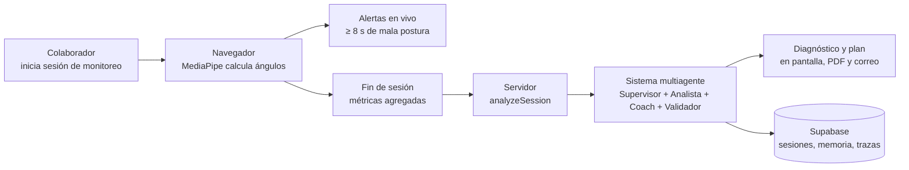

# PosturaIA

Plataforma B2B **multi-tenant** de bienestar postural para equipos de oficina. Mide la postura en tiempo real con la cámara web (visión computacional en el navegador) y, al cerrar cada sesión, un **sistema multiagente de IA** genera un diagnóstico y un plan de acción personalizados, con trazabilidad completa de lo que hizo cada agente.

> **Privacidad por diseño:** el video se procesa solo en el navegador del usuario. Al servidor únicamente llegan métricas numéricas (ángulos, puntaje, alertas).

**Demo en línea:** _pendiente — agregar URL pública (HTTPS)_ · **Video demostrativo:** _pendiente_

---

## Tabla de contenido

- [Características](#características)
- [Cómo funciona](#cómo-funciona)
- [Sistema multiagente](#sistema-multiagente)
- [Stack tecnológico](#stack-tecnológico)
- [Estructura del proyecto](#estructura-del-proyecto)
- [Primeros pasos](#primeros-pasos)
- [Variables de entorno](#variables-de-entorno)
- [Base de datos](#base-de-datos-supabase)
- [Proveedores de IA](#proveedores-de-ia)
- [Proveedores de correo](#proveedores-de-correo)
- [Resumen semanal](#resumen-semanal-por-correo)
- [Despliegue con Docker](#despliegue-con-docker)
- [Salud del servicio](#salud-del-servicio)
- [Pruebas](#pruebas)
- [Scripts](#scripts)
- [Roles y permisos](#roles-y-permisos)
- [Limitaciones conocidas](#limitaciones-conocidas)
- [Documentación relacionada](#documentación-relacionada)

---

## Características

| Área | Qué ofrece |
|---|---|
| **Monitoreo en vivo** | Detección de postura con MediaPipe Pose Landmarker (WASM) en el navegador. Mide ángulo cervical y torácico; funciona con el cuerpo completo o solo con torso superior. |
| **Alertas** | Aviso sonoro y en pantalla ante mala postura sostenida (≥ 8 s); cada alerta se registra. |
| **Diagnóstico con agentes** | Supervisor, Analista, Coach y Validador colaboran para producir diagnóstico, plan de 4 acciones y, si corresponde, una sugerencia de consultar a salud ocupacional. |
| **Memoria por usuario** | El sistema recuerda problemas recurrentes, puntajes recientes y consejos ya dados para no repetirlos. |
| **Trazas auditables** | Cada ejecución guarda delegaciones, mensajes del modelo, herramientas y validación. Visibles en `/traces` y exportables en JSON. |
| **Informes** | Informe PDF por sesión (descarga y envío automático por correo), historial personal con KPIs, tendencia y mapa de actividad. |
| **Panel de RR. HH.** | Indicadores por empleado y por departamento, tendencia comparada con el periodo anterior y exportación CSV. |
| **Privacidad configurable** | Modo `individual` o `aggregate` (seudónimos, grupos pequeños reservados, exportación bloqueada), aplicado por RLS. |
| **Consentimiento** | Aviso de monitoreo versionado que debe aceptarse antes de activar la cámara. |
| **Administración de organización** | Departamentos, invitaciones por correo, roles y baja de miembros. |
| **Resumen semanal** | Correo semanal de bienestar postural a owners y RR. HH. |
| **i18n y tema** | Interfaz en español e inglés; tema claro y oscuro. |

## Cómo funciona



1. El usuario acepta el aviso de monitoreo y activa la cámara.
2. El navegador calcula los ángulos y registra alertas; el video nunca sale del equipo.
3. Al detener la sesión se calculan duración, % de buena postura, ángulos medios, alertas y puntaje (0–100).
4. El servidor valida la entrada, aplica límites de uso y ejecuta el flujo multiagente.
5. El resultado se muestra, se guarda, se puede descargar en PDF y se envía por correo al propio colaborador.

## Sistema multiagente

| Agente | Responsabilidad |
|---|---|
| **Supervisor** | Decide a quién delegar, con qué enfoque, y si se sugiere escalar a salud ocupacional. |
| **Analista biomecánico** | Redacta el diagnóstico postural (3–5 frases) apoyándose en herramientas de umbrales, alertas, tendencia e historial. |
| **Coach de ergonomía** | Convierte el diagnóstico en 4 acciones numeradas usando una biblioteca curada de ejercicios y la memoria del usuario. |
| **Validador** | Revisa coherencia con los datos, idioma, ausencia de diagnósticos médicos o medicación, y formato. |
| **Orquestador** _(código, sin modelo)_ | Límites de uso, memoria, trazas, reglas deterministas, plantilla segura y respaldo. |

Garantías de control: límite de pasos por agente, guardia anti-bucle, tiempos máximos con reintentos, validación de salidas, **herramientas de solo lectura** y respaldo a una cadena fija Analista → Coach si el flujo agéntico falla. Detalle completo en [`ARCHITECTURE.md`](./ARCHITECTURE.md).

## Stack tecnológico

| Capa | Tecnología |
|---|---|
| Framework | TanStack Start (SSR) + TanStack Router + React 19 |
| Build | Vite 8 · Nitro (`node-server`) |
| Estilos y UI | Tailwind CSS v4 · shadcn/ui (Radix UI) · Recharts |
| Backend y datos | Supabase (PostgreSQL, Auth, Row Level Security) |
| IA | Proveedor intercambiable: Ollama (por defecto), Gemini, Grok o gateway de Lovable |
| Visión | `@mediapipe/tasks-vision` (WASM, en el cliente) |
| PDF | jsPDF |
| Validación | Zod |
| Correo | Brevo, Resend o consola |
| Lenguaje y runtime | TypeScript 5 · Node 22 (Bun ≥ 1.2 opcional en desarrollo) |

## Estructura del proyecto

```
src/
├── domain/            Reglas puras y puertos (AIProvider, EmailProvider, tipos de agentes)
├── application/       Casos de uso: agentes (orquestador, herramientas, validadores), reportes, notificaciones
├── infrastructure/    Adaptadores: IA, Supabase, correo, PDF, funciones de servidor, monitoreo
├── presentation/      Vistas, componentes, hooks, i18n y tema
├── routes/            Rutas de TanStack (wrappers delgados) + /health + /api/weekly-digest
supabase/migrations/   Esquema, RLS y runtime agéntico
python/                Script de referencia del algoritmo de postura (no se despliega)
```

Las dependencias solo apuntan hacia adentro (`presentation → application → domain`; `infrastructure` implementa los puertos del dominio). Ver [`ARCHITECTURE.md`](./ARCHITECTURE.md).

## Primeros pasos

### Requisitos

- [Bun](https://bun.sh) ≥ 1.2 **o** Node.js ≥ 20 con npm
- Cámara web (el navegador exige `localhost` o HTTPS para usarla)
- Un proyecto de [Supabase](https://supabase.com) (propio o ya provisto)
- Un proveedor de IA: [Ollama](https://ollama.com) local **o** una API key de Gemini, Grok o Lovable

### Instalación

```bash
git clone <url-del-repositorio>
cd MVP

bun install            # o: npm install

cp .env.example .env   # completa las variables (ver siguiente sección)

# Solo si usas Ollama (proveedor por defecto)
ollama pull qwen3:8b

bun run dev            # o: npm run dev
```

La aplicación queda en `http://localhost:3000`.

## Variables de entorno

Se definen en `.env` (nunca se versiona; usa `.env.example` como plantilla). **No escribas claves reales en el repositorio.**

| Variable | Descripción | Requerida |
|---|---|---|
| `VITE_SUPABASE_URL`, `VITE_SUPABASE_PUBLISHABLE_KEY`, `VITE_SUPABASE_PROJECT_ID` | Conexión de Supabase en el cliente (se incrustan en el build) | Sí |
| `SUPABASE_URL`, `SUPABASE_PUBLISHABLE_KEY`, `SUPABASE_PROJECT_ID` | Conexión de Supabase en el servidor (SSR y `/health`) | Sí |
| `SUPABASE_SERVICE_ROLE_KEY` | Cliente con service role (bypasa RLS). Solo lo usa el resumen semanal | Solo para el resumen |
| `AI_PROVIDER` | `ollama` (por defecto), `gemini`, `grok` o `lovable` | Sí |
| `OLLAMA_BASE_URL`, `OLLAMA_MODEL` | Servidor y modelo de Ollama (`http://localhost:11434`, `qwen3:8b`) | Si `ollama` |
| `GEMINI_API_KEY`, `GEMINI_MODEL`, `GEMINI_MAX_OUTPUT_TOKENS` | Configuración de Gemini | Si `gemini` |
| `XAI_API_KEY`, `XAI_MODEL` | Configuración de Grok | Si `grok` |
| `LOVABLE_API_KEY`, `LOVABLE_AI_MODEL` | Gateway de Lovable | Si `lovable` |
| `EMAIL_PROVIDER` | `console` (por defecto), `brevo` o `resend` | No |
| `BREVO_API_KEY`, `BREVO_EMAIL_FROM`, `BREVO_SENDER_NAME` | Brevo | Si `brevo` |
| `RESEND_API_KEY`, `EMAIL_FROM` | Resend | Si `resend` |
| `LOVABLE_CRON_SECRET` _(alias `CRON_SECRET`)_ | Secreto Bearer del resumen semanal y de `/health?deep=1` | Para cron |
| `LOVABLE_CRON_SECRET_PREVIOUS` | Secreto anterior, para rotar sin downtime | Opcional |

### Parámetros del runtime agéntico (opcionales)

| Variable | Por defecto | Efecto |
|---|---|---|
| `AGENT_MODE` | `agentic` | `agentic` o `pipeline` (cadena fija Analista → Coach) |
| `AGENT_MAX_SUPERVISOR_STEPS` | `5` | Pasos máximos del Supervisor |
| `AGENT_MAX_SPECIALIST_STEPS` | `4` | Pasos máximos de cada especialista |
| `AGENT_MAX_REVISIONS` | `1` | Ciclos de corrección tras el Validador |
| `AGENT_CALL_TIMEOUT_MS` | `45000` | Tiempo máximo por llamada al modelo |
| `AGENT_TOTAL_TIMEOUT_MS` | `120000` | Tiempo máximo del flujo agéntico completo |
| `AGENT_FALLBACK_TIMEOUT_MS` | `60000` | Tiempo máximo del respaldo/pipeline |
| `AGENT_MAX_RETRIES` | `2` | Reintentos con backoff exponencial |
| `AGENT_TEMPERATURE` | `0.2` | Temperatura del modelo |
| `AGENT_MAX_TOKENS` | `700` | Tokens máximos por respuesta |
| `AGENT_RATE_PER_MIN` | `6` | Análisis por minuto y por usuario |
| `AGENT_RATE_PER_DAY` | `100` | Análisis por día y por usuario |

## Base de datos (Supabase)

El esquema vive en `supabase/migrations/` e incluye organizaciones, departamentos, miembros, invitaciones, perfiles, sesiones, alertas y el runtime agéntico (`agent_runs`, `agent_steps`, `agent_memory`). **Todas las tablas tienen RLS habilitado.**

```bash
npm install -g supabase
supabase link --project-ref <tu-project-ref>
supabase db push
```

Backend 100 % local (sin proyecto remoto):

```bash
supabase start        # Postgres, Auth y PostgREST en Docker
supabase db push      # aplica las migraciones
# actualiza SUPABASE_URL / SUPABASE_PUBLISHABLE_KEY en .env con lo que imprime `supabase start`
```

Retención: la función `purge_old_agent_traces(_days)` (por defecto 90 días) elimina trazas antiguas y debe invocarse desde un cron con `service_role`.

## Proveedores de IA

El proveedor se elige con `AI_PROVIDER` y cumple el puerto `AIProvider` (`src/domain/ai/ai-provider.ts`). La lógica de negocio no cambia al cambiar de proveedor.

| `AI_PROVIDER` | Ubicación | Notas |
|---|---|---|
| `ollama` | Local o servidor propio | Sin costo por API; requiere un host Ollama accesible desde el servidor |
| `gemini` | API | Requiere `GEMINI_API_KEY` |
| `grok` | API | Requiere `XAI_API_KEY` |
| `lovable` | Gateway | Requiere `LOVABLE_API_KEY` |

Para añadir uno nuevo: crear `src/infrastructure/ai/providers/<nombre>.provider.ts` implementando `AIProvider`, registrar el `case` en `ai-provider.factory.ts` y definir `AI_PROVIDER`.

> Todos los agentes usan el mismo proveedor y modelo configurados.

## Proveedores de correo

Puerto `EmailProvider` con adaptadores en `src/infrastructure/notifications/providers/`:

- `console` (por defecto): imprime el correo en los logs; ideal para desarrollo. El panel de organización siempre ofrece "Copiar enlace" como respaldo de las invitaciones.
- `brevo` y `resend`: envío real; requieren sus variables.

Se usa para invitaciones, informes de sesión (con PDF adjunto) y resumen semanal. Los envíos son de mejor esfuerzo: si fallan, no bloquean el flujo.

## Resumen semanal por correo

Job de cron expuesto en **`/api/weekly-digest`** (acepta `POST` y `GET`). No hay sesión de usuario detrás, por lo que:

- Usa el cliente de **service role** (`SUPABASE_SERVICE_ROLE_KEY`) y exige `Authorization: Bearer <LOVABLE_CRON_SECRET>` (comparación en tiempo constante).
- Envía a cada owner/RR. HH. un resumen semanal: sesiones, colaboradores activos, puntaje medio, alertas y hasta 5 colaboradores en riesgo alto.
- Es de mejor esfuerzo por organización y destinatario; un fallo puntual se registra y continúa con el resto.

Programación: cualquier scheduler externo (cron del sistema, GitHub Actions, Render Cron Job o Vercel Cron) que llame al endpoint con el header Bearer.

```bash
curl -X POST "https://<tu-dominio>/api/weekly-digest" \
  -H "Authorization: Bearer $LOVABLE_CRON_SECRET"
```

## Despliegue con Docker

El `Dockerfile` es de **producción** (multietapa, Node 22, salida `node-server` de Nitro, puerto 3000).

```bash
docker build \
  --build-arg VITE_SUPABASE_URL=... \
  --build-arg VITE_SUPABASE_PUBLISHABLE_KEY=... \
  --build-arg VITE_SUPABASE_PROJECT_ID=... \
  -t posturaia .

docker run --env-file .env -p 3000:3000 posturaia
```

Notas:

- Las variables `VITE_*` se incrustan en el build; el resto se leen en tiempo de ejecución.
- La imagen **no incluye Ollama**. Con `AI_PROVIDER=ollama`, apunta `OLLAMA_BASE_URL` a un host con el modelo cargado; en servicios pequeños es más práctico usar un proveedor por API.
- `docker-compose.yml` es una configuración de **desarrollo** (monta el código y levanta un servicio `ollama`).
- La cámara requiere HTTPS en producción.

## Salud del servicio

`GET /health` devuelve JSON con `status` (`ok` o `degraded`), `uptimeSeconds` y `checks` (app, Supabase, configuración de IA y proveedor de correo). Responde `200` si está sano y `503` si no.

Con `GET /health?deep=1` y `Authorization: Bearer <LOVABLE_CRON_SECRET>` se comprueba además que el proveedor de IA sea alcanzable.

## Pruebas

El repositorio incluye 42 pruebas unitarias del runtime agéntico en `src/application/agents/__tests__/` (bucle de agente, orquestador, validadores, memoria, resiliencia). Usan un proveedor de IA simulado: no requieren red ni base de datos.

Para ejecutarlas hace falta [Vitest](https://vitest.dev) y el alias `@`:

```bash
npm i -D vitest
```

```ts
// vitest.config.ts
import { defineConfig } from "vitest/config";
import path from "node:path";

export default defineConfig({
  resolve: { alias: { "@": path.resolve(__dirname, "src") } },
  test: { include: ["src/**/__tests__/*.test.ts"] },
});
```

```bash
npx vitest run
```

## Scripts

| Comando | Descripción |
|---|---|
| `bun run dev` | Servidor de desarrollo en `localhost:3000` |
| `bun run build` | Build de producción |
| `bun run build:dev` | Build en modo desarrollo |
| `bun run preview` | Sirve el build de producción |
| `bun run lint` | ESLint |
| `bun run format` | Prettier |

## Roles y permisos

| Rol | Monitoreo | Mis informes | Trazas propias | RR. HH. | Organización |
|---|:---:|:---:|:---:|:---:|:---:|
| `employee` | ✅ | ✅ | ✅ | — | — |
| `hr` | ✅ | ✅ | ✅ (y ajenas solo en modo `individual`) | ✅ | ✅ (sin editar roles ni quitar miembros) |
| `owner` | ✅ | ✅ | ✅ (y ajenas solo en modo `individual`) | ✅ | ✅ (control total y modo de privacidad) |

## Limitaciones conocidas

- El inicio de sesión con Google está preparado en el código, pero no funciona fuera del editor de Lovable.
- `GET /health` marca `degraded` (503) cuando `AI_PROVIDER` es `gemini` o `grok`, porque la comprobación de configuración solo reconoce `ollama`, `lovable` y `openai`.
- No hay un paso de aprobación humana dentro del flujo de agentes: los agentes solo leen y recomiendan; no ejecutan acciones con efecto externo.
- No existe RAG con embeddings: los ejercicios provienen de una biblioteca curada y estática incluida en el código.
- La herramienta `get_session_metrics` está definida pero no está asignada a ningún agente.

## Documentación relacionada

- [`ARCHITECTURE.md`](./ARCHITECTURE.md): capas, componentes, flujo multiagente, modelo de datos, seguridad y despliegue (con diagramas Mermaid).
- [`VISTAS.md`](./VISTAS.md): especificación funcional de cada pantalla, rutas y permisos.
