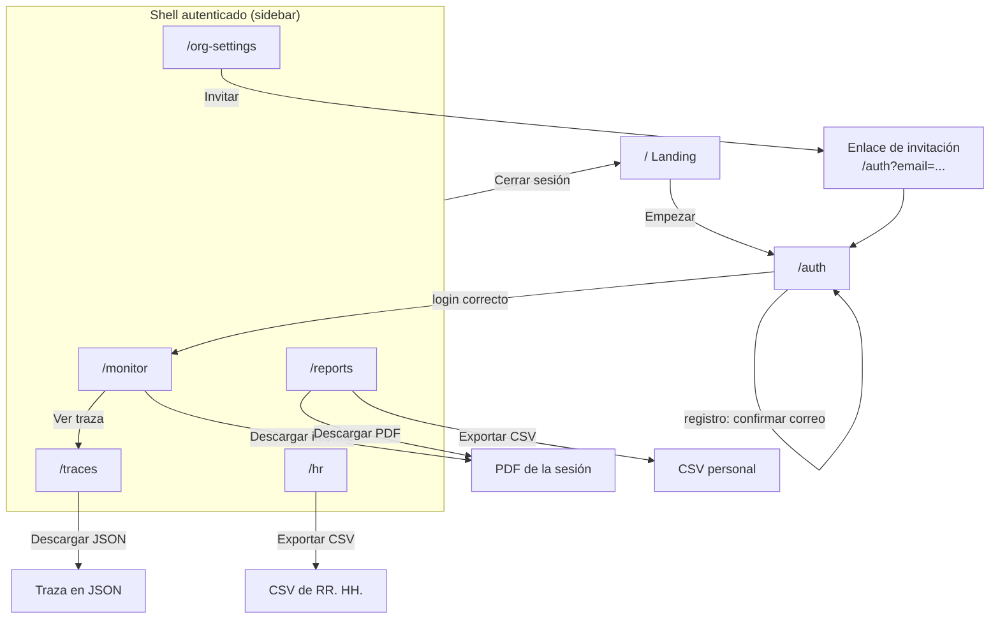

# Vistas de PosturaIA — especificación funcional

Referencia de la capa de presentación: ruta, rol que accede, apartados y funcionalidad de cada pantalla. No describe estilos ni implementación; sirve para entender, probar o rediseñar el frontend sin tocar dominio, aplicación ni infraestructura.

Las vistas viven en `src/presentation/views/`. Cada una se monta en una ruta delgada de `src/routes/` (solo asocia URL ↔ vista y define metadatos SEO). El shell de navegación (`AppShell`) envuelve todas las vistas autenticadas.

## Tabla de contenido

1. [Mapa de rutas](#1-mapa-de-rutas)
2. [Navegación entre vistas](#2-navegación-entre-vistas)
3. [Shell de navegación (AppShell)](#3-shell-de-navegación-appshell)
4. [Landing (`/`)](#4-landing-)
5. [Login y registro (`/auth`)](#5-login-y-registro-auth)
6. [Monitoreo (`/monitor`)](#6-monitoreo-monitor)
7. [Mis informes (`/reports`)](#7-mis-informes-reports)
8. [Trazas de agentes (`/traces`)](#8-trazas-de-agentes-traces)
9. [Panel de RR. HH. (`/hr`)](#9-panel-de-rr-hh-hr)
10. [Organización (`/org-settings`)](#10-organización-org-settings)
11. [Endpoints no visuales](#11-endpoints-no-visuales)
12. [Roles y accesos](#12-roles-y-accesos)
13. [Estados transversales](#13-estados-transversales)

---

## 1. Mapa de rutas

| Ruta | Vista | Acceso | Archivo de vista |
|---|---|---|---|
| `/` | Landing | Pública | `LandingView.tsx` |
| `/auth` | Login y registro | Pública | `AuthView.tsx` |
| `/monitor` | Monitoreo en vivo | Autenticado | `MonitorView.tsx` |
| `/reports` | Mis informes | Autenticado | `ReportsView.tsx` |
| `/traces` | Trazas de agentes (`?run=<id>`) | Autenticado | `TracesView.tsx` |
| `/hr` | Panel de RR. HH. | `owner` o `hr` | `HrView.tsx` |
| `/org-settings` | Organización | `owner` o `hr` | `OrgSettingsView.tsx` |
| `/health` | Estado del servicio (JSON) | Pública (`?deep=1` con secreto) | — |
| `/api/weekly-digest` | Resumen semanal (cron) | Secreto Bearer | — |

Todas las rutas bajo `_authenticated` exigen sesión: si no hay usuario, redirigen a `/auth`.

## 2. Navegación entre vistas

## 3. Shell de navegación (AppShell)

Envuelve **todas** las vistas autenticadas. No es una ruta propia: es el layout común.

**Apartados**

- **Sidebar**: marca "PosturaIA", bloque de organización y usuario, navegación por rol y botón "Cerrar sesión". Se puede **colapsar** (la preferencia se recuerda en el navegador) y en móvil se abre como cajón.
- **Navegación**
  - Siempre: "Monitoreo" (`/monitor`), "Mis informes" (`/reports`) y "Trazas" (`/traces`).
  - Solo `owner` u `hr`: "RR. HH." (`/hr`) y "Organización" (`/org-settings`).
- **Barra superior**: breadcrumb, badge de procesamiento local, selector de idioma (ES/EN) y selector de tema (claro/oscuro).
- **Área de contenido**: la vista activa.

**Funcionalidad:** resuelve el rol del usuario (`owner`, `hr`, `employee`) para mostrar u ocultar enlaces, marca el enlace activo y cierra sesión (invalida la sesión y redirige a `/`). Al navegar en móvil, el cajón se cierra.

---

## 4. Landing (`/`)

Pública, sin autenticación. Página de entrada y marketing.

**Apartados**

1. **Header**: logo, selector de idioma y botón de inicio (lleva a `/auth`).
2. **Hero**: badge de confianza/privacidad, título, subtítulo, dos CTA ("Empezar" → `/auth`, "Cómo funciona" → ancla `#how`) y nota de privacidad.
3. **Características** (4 tarjetas): monitoreo en tiempo real, diagnóstico con IA, alertas proactivas y panel de equipo.
4. **Cómo funciona** (`#how`): 3 pasos numerados.
5. **Footer**: marca y lema.

**Funcionalidad:** página estática e informativa, sin llamadas a datos; todo el texto sale de las traducciones ES/EN. Su único objetivo es llevar al visitante a `/auth`.

---

## 5. Login y registro (`/auth`)

Pública. Un solo formulario con dos modos (`signin` / `signup`) alternables con un botón de texto.

**Apartados**

1. **Header mínimo**: logo (vuelve a `/`) e idioma.
2. **Tarjeta de formulario**
   - Solo en registro: "Nombre completo" (requerido) y "Nombre de tu organización" (opcional, con ayuda: si se deja vacío se une a una organización por defecto; si coincide con una existente, se une a ella).
   - En ambos modos: correo y contraseña (mínimo 6 caracteres).
   - Botón de envío ("Iniciar sesión" / "Crear cuenta").
   - Separador "o" y botón "Continuar con Google".
   - Enlace para alternar entre modos.
3. **Nota de privacidad**.

**Funcionalidad**

- Con sesión activa, redirige a `/monitor` sin mostrar el formulario.
- **Enlace de invitación:** si la URL trae `?email=...` (generado desde Organización), precarga el correo y abre el modo registro; el invitado se une a la organización automáticamente al registrarse con ese correo.
- **Registro:** crea la cuenta, exige confirmación por correo y no inicia sesión automáticamente.
- **Login:** autentica y redirige a `/monitor`.
- **Google:** el flujo está preparado pero **no funciona fuera del editor de Lovable**.
- Los errores (credenciales inválidas, correo ya registrado, etc.) se muestran como toast.

---

## 6. Monitoreo (`/monitor`)

Autenticada. Vista principal tras iniciar sesión: aquí el colaborador corre una sesión de monitoreo en vivo y recibe el informe de los agentes.

**Apartados**

1. **Encabezado**: título y nota de privacidad (el video no se graba ni se envía; el análisis es local).
2. **Panel de cámara (columna principal)**
   - Video en vivo con superposición del esqueleto detectado.
   - Estados previos: "cámara inactiva" y "cargando modelo".
   - Badge de estado postural: "Buena postura", "Postura incorrecta" o "No se detecta a la persona".
   - Controles: iniciar/detener sesión, silenciar alertas sonoras e indicador del modo de detección ("cuerpo completo" o "solo torso/hombros").
3. **Panel de métricas (columna lateral)**
   - Seis métricas en vivo: tiempo, % de buena postura, ángulo de cuello, ángulo de torso/hombros (ambos con aviso al exceder el límite), alertas y puntaje ergonómico (0–100).
   - Consejos de ergonomía (texto fijo).
   - Guía de colocación de la cámara (imagen y texto).
4. **Diálogo de consentimiento** (modal): aparece antes de la primera sesión y cada vez que cambia la versión del aviso. Explica qué se mide, qué se guarda, quién lo ve (según el modo de privacidad de la organización) y que la IA no da consejo médico. Requiere marcar la casilla y aceptar.
5. **Resultados** (solo tras finalizar una sesión)
   - Estado "analizando…" mientras trabajan los agentes.
   - Tarjeta con puntaje, % de buena postura, ángulo de cuello y alertas, y botón "Descargar informe PDF".
   - **Chips de agentes:** número de agentes y herramientas usados, estado "Validado" o "Con observaciones", y "Modo de respaldo" o "Cadena fija" cuando corresponde.
   - Enlace **"Ver traza"** que abre `/traces?run=<id>`.
   - **Aviso de escalamiento:** "Te sugerimos consultar con salud ocupacional" cuando el sistema lo recomienda.
   - Dos bloques de texto: **Diagnóstico** (Analista) y **Recomendaciones** (Coach).
   - Descargo: orientación informativa generada por IA, no constituye diagnóstico ni consejo médico.

**Funcionalidad**

- **Iniciar:** exige pertenecer a una organización y haber aceptado el consentimiento; pide permiso de cámara, carga MediaPipe, crea la sesión en la base de datos y arranca el bucle de detección.
- **Durante la sesión:** calcula ángulos de cuello y torso/hombros; con mala postura sostenida (≥ 8 s) emite sonido (si no está silenciado), muestra la alerta y la registra. El modo de medición alterna solo entre cuerpo completo y torso/hombros según los puntos visibles.
- **Detener:** congela cámara y detección, calcula las métricas y las envía al servidor para el análisis multiagente; guarda la sesión con diagnóstico y recomendación; envía el informe PDF al correo del colaborador en segundo plano, sin bloquear ni mostrar error si falla.
- **Límite de uso:** si se alcanza (6 por minuto o 100 por día), la sesión se guarda y se muestra un aviso para reintentar el análisis más tarde.
- **Error de análisis:** se notifica con un toast y la sesión se guarda igualmente.
- **Descargar informe:** genera el PDF en el cliente con métricas, diagnóstico y recomendación.

---

## 7. Mis informes (`/reports`)

Autenticada. Historial personal de sesiones finalizadas.

**Apartados**

1. **Encabezado**: título, subtítulo y controles de periodo (últimos 7 días, mes, todo) y exportación CSV.
2. **KPIs**
   - Índice ergonómico medio con comparación contra el periodo anterior y tendencia en miniatura.
   - Porcentaje de sesiones en riesgo bajo.
   - Actividad: horas, número de sesiones, duración media y alertas totales.
   - Constancia: días activos de la semana y racha actual.
3. **Gráfico de evolución**: puntaje por día con línea de umbral y promedio.
4. **Mapa de actividad**: concentración de sesiones por día y franja, con la hora pico.
5. **Lista de sesiones**
   - Filtro por nivel de riesgo (todos, bajo, medio, alto).
   - Una tarjeta por sesión (más reciente primero) con fecha relativa ("hoy", "ayer"), duración, puntaje, badge de riesgo, botón "Descargar PDF", métricas (% de buena postura, cuello, torso, alertas) y el texto de diagnóstico y recomendación si existen.
6. **Estado vacío** si no hay sesiones en el periodo.

**Funcionalidad:** solo lectura sobre las sesiones propias. Cada PDF se regenera con los datos ya guardados, sin volver a llamar a la IA. El CSV exporta las sesiones filtradas.

---

## 8. Trazas de agentes (`/traces`)

Autenticada. Registro auditable de lo que hicieron los agentes en cada análisis. Sirve como evidencia de la colaboración entre agentes en una misma solicitud.

**Apartados**

1. **Encabezado**: título, subtítulo y, para `owner`/`hr`, una nota indicando que ven las ejecuciones de la organización cuando el modo de privacidad lo permite.
2. **Tabla de ejecuciones**: fecha, usuario ("Tú" o "Colaborador ·XXXX" para ajenos), modo (Agéntico, Cadena fija o Respaldo), estado (Correcto, Con respaldo, Error o En curso), duración, llamadas (modelo y herramientas) y validación (Aprobada o Con observaciones).
3. **Detalle de una ejecución** (fila expandible; se abre sola con `?run=<id>`)
   - Resumen: tokens aproximados y si sugirió consultar a salud ocupacional.
   - **Pasos de la ejecución**, en orden, con tipo (Modelo, Herramienta, Delegación, Validación, Memoria, Sistema), agente, profundidad, estado, duración y, al abrir cada paso, su **entrada**, **salida** y **error**.
   - Botón **"Descargar JSON"** con la ejecución y sus pasos.
4. **Estados:** cargando, vacío ("sin ejecuciones") y "esta ejecución no registró pasos".

**Funcionalidad:** solo lectura. Un colaborador ve sus propias ejecuciones; `owner`/`hr` ven las de la organización **solo si el modo de privacidad es `individual`** (lo aplica RLS). Las cadenas largas se muestran recortadas.

---

## 9. Panel de RR. HH. (`/hr`)

Autenticada, **solo `owner` u `hr`**. Vista agregada de bienestar postural del equipo.

**Apartados**

1. **Encabezado**: título, chips de contexto (acceso restringido, datos aislados por organización, número de colaboradores activos y, en modo agregado, "Modo agregado" con los departamentos reservados), selector de periodo (semana, mes, trimestre) y botón "Exportar CSV".
2. **Cuatro KPIs**
   - Colaboradores monitoreados y cobertura sobre el total de miembros.
   - Sesiones, horas totales, comparación con el periodo anterior y horas por persona.
   - Puntaje medio del equipo, variación y alertas.
   - Colaboradores en riesgo alto, con botón "Ver casos" que filtra la tabla.
3. **Tendencia**: puntaje del periodo actual comparado con el anterior.
4. **Por departamento**: puntaje medio por departamento, colaboradores monitoreados sobre el total y el departamento con peor puntaje.
5. **Tabla por empleado**
   - Búsqueda, filtro por departamento (incluye "sin departamento") y filtro por nivel de riesgo.
   - Columnas: empleado, departamento, sesiones, puntaje, nivel, última sesión y acción.
   - Fila expandible con último ángulo de cuello y torso y el diagnóstico más reciente.

**Funcionalidad**

- Lee las sesiones finalizadas de la organización y las cruza con los miembros para calcular KPIs, tendencia, promedios por departamento y la tabla.
- **Modo `aggregate`:** los empleados aparecen con seudónimo, los grupos pequeños se reservan y **se bloquea la exportación CSV**.
- Sin rol `owner`/`hr`, muestra un mensaje de "sin acceso" en lugar del contenido.

---

## 10. Organización (`/org-settings`)

Autenticada, **solo `owner` u `hr`**. Administración del tenant en secciones independientes.

**Apartados**

1. **Encabezado**: título con el nombre de la organización y subtítulo.
2. **Privacidad de RR. HH.** (`PrivacySettingsCard`): selector entre modo `individual` (RR. HH. ve puntajes e informes por colaborador) y `aggregate` (solo indicadores agregados). **Solo el `owner` puede cambiarlo**; para `hr` es de solo lectura.
3. **Departamentos**: formulario para crear uno, contador de activos y lista con botón "Eliminar" (con confirmación).
4. **Invitaciones**
   - Formulario: correo, rol (`employee` o `hr`), departamento (opcional) y "Enviar invitación".
   - Lista de pendientes: correo, rol, departamento, vencimiento (por ejemplo "vence hoy" o "vence en N días"), badge de estado (pendiente o expirada), "Copiar enlace" y "Cancelar".
5. **Miembros**: tabla con nombre y correo, rol (editable por `owner`), departamento (editable por `owner`) y "Quitar" (solo `owner`, nunca sobre sí mismo).

**Funcionalidad**

- **Departamentos:** crear y eliminar; al eliminar uno, sus miembros quedan sin departamento.
- **Invitar:** crea la invitación (válida 7 días) y dispara en paralelo el correo con el enlace de registro precargado (mejor esfuerzo); siempre ofrece "Copiar enlace" como respaldo. Un correo con invitación pendiente duplicada muestra un error específico; un correo inválido, otro.
- **Cancelar invitación:** revoca el enlace.
- **Miembros:** solo el `owner` cambia rol o departamento de otros y los quita; a `hr` la tabla le aparece en solo lectura.
- Cada acción refresca su sección al terminar.

---

## 11. Endpoints no visuales

| Endpoint | Método | Descripción |
|---|---|---|
| `/health` | `GET` | JSON con `status` (`ok` o `degraded`), `uptimeSeconds` y `checks` (app, Supabase, IA, correo). `200` si está sano, `503` si no. Con `?deep=1` y secreto Bearer comprueba además la alcanzabilidad del proveedor de IA |
| `/api/weekly-digest` | `POST` / `GET` | Envía el resumen semanal a owners y RR. HH. Exige `Authorization: Bearer <LOVABLE_CRON_SECRET>` |

## 12. Roles y accesos

| Rol | Monitoreo | Mis informes | Trazas | RR. HH. | Organización |
|---|:---:|:---:|:---:|:---:|:---:|
| `employee` | ✅ | ✅ (solo lo propio) | ✅ (solo las propias) | ❌ | ❌ |
| `hr` | ✅ | ✅ (solo lo propio) | ✅ propias; ajenas solo en modo `individual` | ✅ (todo el equipo) | ✅ (ver, invitar, departamentos; **no** edita roles ni quita miembros ni cambia la privacidad) |
| `owner` | ✅ | ✅ (solo lo propio) | ✅ propias; ajenas solo en modo `individual` | ✅ (todo el equipo) | ✅ (control total, incluidos miembros y modo de privacidad) |

El rol se resuelve una vez por sesión de navegación mediante el contexto de organización y controla tanto los enlaces visibles como el contenido de cada vista protegida. La seguridad real la aplica RLS en la base de datos.

## 13. Estados transversales

Considerar siempre estos estados al reimplementar una vista:

- **Cargando** (`common.loading`): texto simple mientras se resuelven organización y consultas.
- **Vacío:** listas sin datos (sin sesiones, ejecuciones, departamentos, invitaciones o miembros) con mensaje de texto.
- **Sin acceso:** vistas protegidas por rol muestran un mensaje de texto, no un error ni una redirección.
- **Notificaciones (toast):** todas las acciones confirman éxito o error con un toast no bloqueante.
- **Confirmación destructiva:** eliminar departamento, cancelar invitación y quitar miembro piden confirmación (hoy con `window.confirm`; a reemplazar por el patrón de diálogo del diseño).
- **Consentimiento:** diálogo modal que bloquea el inicio del monitoreo hasta ser aceptado.
- **Privacidad:** los chips y bloqueos del modo `aggregate` deben mostrarse siempre que aplique.
- **Bilingüe (ES/EN):** todo el texto sale del diccionario de `presentation/i18n/messages/` (`shell`, `monitor`, `reports`, `hr`, `org`, `agentic`); no hay texto fijo en las vistas.
- **Tema:** claro y oscuro, persistente.
- **Accesibilidad:** grupos de opciones con `role="radiogroup"` y etiquetas ARIA en filtros y controles.
